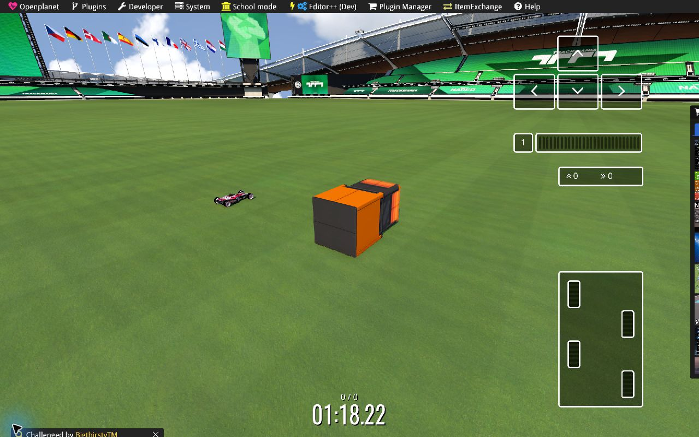
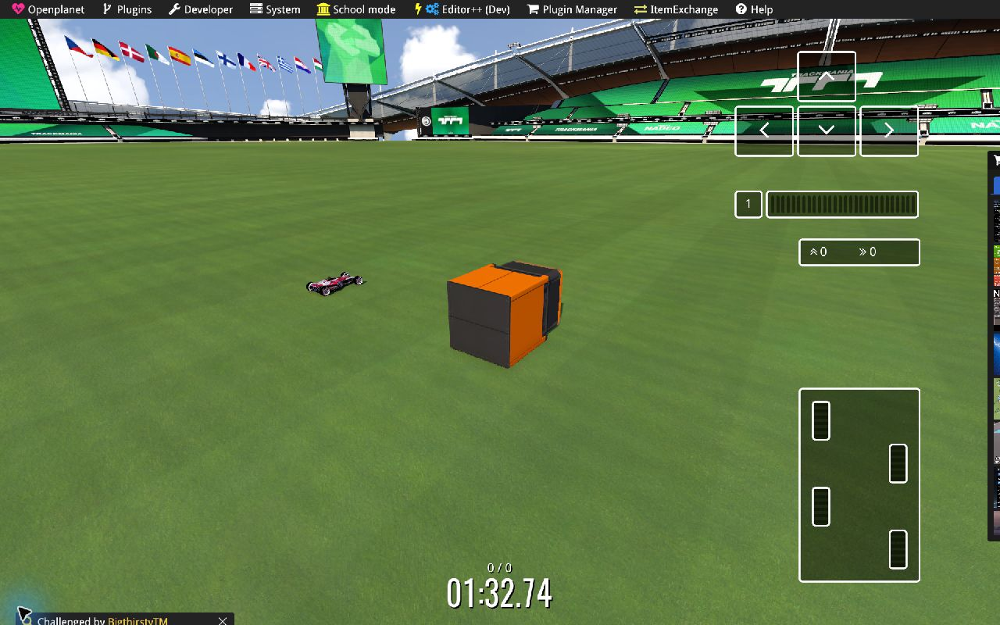

# Approved audit fixes — 20 October 2026

The approved batches were executed in order. The reproduced Studio workflow defects are fixed and covered by regression tests. Native tests now demonstrate inventory discovery, placement, map save/reopen, macroblock transforms, and visible motion for representative browser exports. Some native compatibility questions remain open; they are listed explicitly below.

The work started from commit `64b9cd2` with an already modified checkout. Existing material, GameData, parser, and vendor changes were preserved and included in the requested source commit. The original audit and full local working evidence remain under `artifacts/audit-2026-10-20` and `artifacts/fixes-2026-10-20`. A small, reviewable evidence set is committed under [evidence/audit-fixes-2026-10-20](evidence/audit-fixes-2026-10-20).

## Batch A — workflow and data integrity

| Finding | Implemented behavior | Verification |
|---|---|---|
| F01: pink highlight survives deselection | Restores zero-valued base emissive colors; clears viewport/composite selection consistently; filters picking to selectable meshes with visible ancestors; excludes transform-control pickers | Actual pointer selection/empty-space deselection, scene refresh, composite source switching, and ordered callbacks pass |
| F02: numpad views fail after toolbar clicks | Canvas takes keyboard focus; toolbar buttons no longer suppress numpad views; editable controls retain their keys; physical numpad codes support NumLock-off navigation keys | Top/Front/Right/projection after toolbar and loaded-item buttons; input and ordinary Home-key guards pass |
| F03: flag conversion without placement fails | Creates the missing place-parameter representation and its serialization reference; validates before exposing the result; unsupported normalization-off conversion refuses atomically | Browser conversion/export/reopen and 74 flag checks pass |
| F06: UI offers unsupported segment counts | Uses `ItemMotion.MaxSegments` (4); unsupported legacy counts remain disabled rather than being silently rewritten | Browser selector and motion roundtrip/refusal tests pass |

The inspector's active document is separate from selected viewport geometry. Clicking empty space clears the highlight and composite selection without closing the document. Loaded-item navigation and viewport selection use one ordered update path.

## Batch B — Helper, layout, and clarity

| Finding | Implemented behavior | Verification |
|---|---|---|
| F04: generic or inaccurate Helper text | Specific descriptions for settings, actions, sections, axes, mesh switches, timeline units, and export modes; honest preview/read-only/unknown limitations; keyboard-focus support | Helper coverage samples all enabled controls/actions in the exercised panels; hover/focus and Helper-off states pass |
| F05: narrow-screen overflow | Wrapping header actions, bounded loaded-item navigation, long-filename handling, and deliberate local table scrolling | 390/768/1280/1440 px coverage; desktop/laptop/mobile and 16 long item names pass |
| F07: absolute collision claims | Describes generated collision and the remaining native validation requirement instead of promising 100% parity | Wording and capability tests pass; no unsupported native collision claim is made |
| F08: English, accessible names, version | English messages; part-specific mesh switch names and axis labels; visible Studio version 0.4.3 matches the project | Browser accessibility/name checks, both themes, and successful build |

Helper uses explicit keys for the covered settings. Unknown semantics are disclosed rather than replaced with invented explanations. Future controls still need their own description and coverage case.

## Batch C — icon, material, camera, and test investigations

### I02: icons

Raw GBX.NET icon arrays are read as `[x,y]` using their actual dimensions. Stored GBX WebP rows receive the required vertical flip. `IconQuarterRotationY` describes native model auto-render orientation and is no longer applied as an extra rotation to stored image pixels.

Image upload/drop center-crops and normalizes to 64×64, stores both supported representations, and creates the icon header when the source lacks one. Invalid uploads leave the previous image intact. Superseded asynchronous renders cannot overwrite a newer source. Missing, black, fully transparent, unsupported external bitmap, and decode-failure states have distinct feedback rather than an unexplained black preview.

Verified cases include rectangular raw icons, colored quadrants, WebP orientation, the rotation metadata field, a missing icon header, invalid-image atomicity, stale-pixel clearing, actual drop, export, and reopen. Four model invariants and the complete browser icon suite pass.

**Still open:** the exact original CPlugBitmap/DXT files behind the reported black preview were unavailable. An external bitmap reference is now explained, but this change does not add a universal external CPlugBitmap/DXT resolver. Native inventory orientation of the replacement quadrant icon was not visually verified; native loading and placement alone do not close that question.

### I03: material preview

The repaired suite completes the intended UV/material coverage: UV0 payloads and per-mesh mappings, animated water/glass, deterministic exact-link and token matching, PBR base/normal/roughness bindings, authored color masks, ATI1/ATI2 (BC4/BC5), neutral fallback, stale loads, and export byte neutrality. Selecting local textures or moods does not modify item data.

The inherited local GameData pipeline remains available. Ten optional real-asset geometry/material checks pass, including vehicles and pilot meshes. Pilot archives remain explicitly partial, read-only static rest poses. This is not native character-animation support or proof of game-identical lighting.

### I04: camera contract

Ordinary scene edits preserve the camera. Explicit reset/new-document framing uses visible geometry bounds rather than hidden collision/helper extents. Canonical views restore a stable world-up direction; changing camera views does not rotate the world grid. The typed-viewer suite now asserts that contract and completes all 17 groups.

The native floor confirms a 48×48 Stadium footprint with 32 m horizontal cells: **1536×1536 m**. That existing grid size was correct and did not require another product change.

### T01: stale browser coverage

Updated obsolete labels, selectors, layout assumptions, and export expectations so the affected suites reach their intended assertions. This includes variant navigation through all nine SnowCar variants, compact loaded-item navigation, typed camera framing, kinematic workflows, collection export, capability gating, and diagnostics export.

The parser update workflow also restores its test projects explicitly, installs both required SDK/runtime generations, and checks sentinel, surface, and scene coverage. Documentation now identifies both bundled compatibility patches. The updater's recursive temporary-directory cleanup validates the resolved target before removal. The GitHub-hosted workflow itself was not executed during this local run.

## Batch D — native integration evidence

Runtime: Trackmania `2026-02-02 17:51:19`, v3.3.0; Openplanet 1.29.14 next/Public `6fd4200f`; tm-control-mcp 0.4.0; E++ pack 80 tools. The installed known-good `Editor.op` was retained, not rebuilt; SHA-256 `a07d1450ff06ca281bbfd5b1f44b7c08e647a2c13d472e1efd7ac4e4036fa644`.

### Fresh exports, inventory, and saved map

[native-export-fixtures.cjs](../Tests/Browser/native-export-fixtures.cjs) creates the test files through real browser import/edit/export actions. Final files use distinct IDs and filenames under `Documents/Trackmania/Items/TMIS_Final_20261020`; the native macroblock is under `Documents/Trackmania/Macroblocks/TMIS_Final_20261020`. Earlier cached/preloaded attempts are not promoted as proof that the final bytes ran.

| Export | Native evidence | Limit |
|---|---|---|
| Selected static item | Inventory-visible; placed; saved/reopened at `(704,8,768)` | Representative SupportConnector source |
| Two-copy multi-instance item | Inventory-visible; placed; saved/reopened at `(736,8,768)` | Does not establish every possible instance transform |
| Merged item | Inventory-visible; placed; saved/reopened at `(784,8,768)` | No blanket motion/collision parity claim |
| Combined variants | Inventory-visible; variant 0 placed; saved/reopened at `(832,8,768)` | Native switching to other variants remains unverified |
| Native pusher roundtrip | Inventory-visible; saved/reopened at `(768,8,816)`; visible movement in native playtest | Preserves an approved pusher; does not prove every generated motion preset |
| Replacement icon item | Native model accepted, inventory-visible, placed, saved/reopened | Native icon pixels/orientation not observed |
| Flag-converted item | Native model accepted, inventory-visible, placed, saved/reopened | Signature/placement conversion does not create cloth or a pole |
| Two-item macroblock | Native placement adds two real instances; saved/reopened at `(736,8,704)` and `(752,8,704)`, second yaw 90° | Native placement uses untagged instances, cleaned separately by verified indices |

The final native map reopened with **all nine instances**, matching IDs, positions, scale, and the macroblock rotation. See [reopened item readback](evidence/audit-fixes-2026-10-20/mcp-final-reopened-items.json), [readiness/floor dimensions](evidence/audit-fixes-2026-10-20/mcp-final-reopen-ready.json), and [exact export hashes](evidence/audit-fixes-2026-10-20/native-export-manifest.json).

Saved evidence map: `Documents/Trackmania/Maps/My Maps/TMIS_Fixes_20261020/TMIS_Final.Map.Gbx`, 103,957 bytes, SHA-256 `0b87818080d8e57c7e3d9d9aae6f6ab1763b75d62aaf80256f164aae9ffd2428`.

Two observations from a fixed native free camera show different pusher extension phases during `MapEditor_Test`:





The car remained away from the pusher during these captures. **Contact/collision parity is not tested by those images.** A controlled original/export contact comparison across motion phases is still required before promoting complex generated presets.

### I01: Item Editor crash comparison

| Condition | Observed result |
|---|---|
| Audit: original SupportConnector, E++ `leave` action | Game access violation at `Trackmania.exe+0xB9D61D`, read `0xF0`, `rcx=0` |
| Original SupportConnector, native Back button | Returned to map editor once; Editor++ callback warning remained |
| Studio SupportConnector export, native Back button, baseline plugins | Crashed at 16:34:56 at the same fault address; therefore not specific to the MCP exit action |
| Same Studio export, native Back button, only EditorDeveloper unloaded | Returned to map editor and remained responsive; Editor++ callback warning remained |

Immediately before the reproduced export crash, EditorDeveloper logged `Patched! Backup: 0F 84 96 04 00 00`. The one-variable comparison makes an editor-plugin interaction a credible lead. One successful isolated exit does not establish causation or justify changing Studio serialization. A minimal-plugin/repeated controlled comparison is the next diagnostic step; no speculative product or Editor++ patch was made.

During setup, two native menu selections unloaded adjacent leaf plugins instead of the intended one. Both were restored before the actual isolated comparison. Their unloads are not counted as an EditorDeveloper experiment. The final loaded/enabled set matches the retained 67-plugin baseline exactly. The built-in EditorDeveloper reload is proven by a fresh `Loaded plugin 'EditorDeveloper'` line; an earlier failed host load response contained a stale line and was not accepted as lifecycle evidence.

### Native tooling and parser limits

- E++ `SelectItemModel` could not resolve the final icon through the attempted cache paths after map reopen. Broad `ControlInventory` selection then exceeded the 15-second script budget in `FindArticleRecursive`. The game remained alive and responsive; this was a tool timeout, not another native crash. The broad query was not repeated.
- Native screenshot requests during playtest timed out without creating the requested files. The two motion images above were captured through the Computer Use skill instead.
- Strict GBX.NET inspection of a native-saved map fails on lightmap cache chunk `0304305B`. `ProbeAssets --skip-lightmap-cache` now explicitly labels placement-only inspection and returns failure status on parse errors. It successfully reads the earlier four-item evidence map.
- The final macroblock-bearing map additionally reaches unsupported `03043040` association data (`U07 has something else than -1`). That placement-related chunk is not silently skipped. The stronger result here is native save/reopen/readback of all nine objects, not an offline parser pass.
- Newly staged files may require a game restart before native inventory/FID metadata is current. Reused filenames exposed stale metadata in preliminary runs; final tests used a fresh directory and IDs.

### Cleanup

The two verified macroblock instances and seven tagged items were removed from the live test map; `GetItems` reports zero, the active tag is empty, and Trackmania returned to Menu. Runtime deletions were discarded, preserving the saved nine-instance evidence map. All original plugin IDs and enabled states were restored. Full local logs and saved test assets remain available; no user map was overwritten by cleanup.

## Validation and reproducibility

All 12 model suites pass: **365 numbered checks plus four icon invariants**. Ten optional local GameData checks also pass. The texture-library utility builds successfully. The icon suite is included in the shared test runner; argument-driven asset tools are built there without running corpus mutations. See [model results](evidence/audit-fixes-2026-10-20/model-results.json) and adjacent logs.

Browser suites completed successfully for workflow regressions, Helper coverage, icon pipeline, 17 typed-viewer groups, material preview, variant navigation, compact layout, kinematic segments/preservation, capability gating, collection export, diagnostics export, and light/dark editor shell. The workflow suite also passes against the final development server, rather than only the frozen port-5202 build.

`dotnet build TM-Item-Studio.csproj --no-restore` succeeds with one existing NativeFileReference warning: the NativeSharpLzo native archive is not linked when native/AOT compilation is disabled. Browser roundtrips exercise the configured runtime path; the warning is not suppressed or counted as an error.

Final HTTP checks show localhost:5183 serving current HTML, viewer, icon, Helper, and CSS bytes. The collaborative preview loads without a page error or browser-refresh 404 in the observed request set. The exact checked asset/parser/map hashes are in [final provenance](evidence/audit-fixes-2026-10-20/final-provenance.json).

Run from the repository root:

```powershell
dotnet build TM-Item-Studio.csproj
dotnet run --project Tests/FlagConversion
dotnet run --project Tests/ItemIcons
dotnet build Tests/ProbeAssets
npm ci --prefix Tests/Browser
$env:STUDIO_BASE_URL = 'http://localhost:5183'
npm --prefix Tests/Browser run test:workflow-regressions
npm --prefix Tests/Browser run test:helper-coverage
npm --prefix Tests/Browser run test:icon-pipeline
```

For fresh browser exports intended for a separately controlled MCP session:

```powershell
$env:STUDIO_NATIVE_EXPORTS = (Join-Path $PWD 'artifacts/native-review')
$env:STUDIO_NATIVE_ID_PREFIX = 'TMIS_Review'
$env:STUDIO_NATIVE_EXTENDED = '1'
npm --prefix Tests/Browser run test:native-fixtures
```

This utility writes exports and a hash manifest; it does not start the game or place content automatically. Stage to a unique native folder, tag mutations, inspect actual map state, and restore the session afterward. Do not infer native success from a socket envelope or a preload result alone.

## Remaining acceptance work

1. Obtain minimal originals for the reported external CPlugBitmap/DXT icon failures; test their exact dependency and encoding paths.
2. Visually confirm uploaded icon orientation and auto-render interaction in native inventory; verify native cycling of combined variants.
3. Compare original/export contact through moving phases, including generated nested/chained carrier presets. Keep native timelines at four segments or fewer.
4. Finish the Item Editor crash matrix with a minimal documented plugin set; investigate EditorDeveloper/E++ interactions outside Studio serialization.
5. Add parser support for the native lightmap/macroblock association variants before claiming strict offline inspection of those saved maps.

No extra roadmap features or experimental tools from the audit were implemented in these batches. These unresolved items are disclosed rather than treated as successful fixes.
